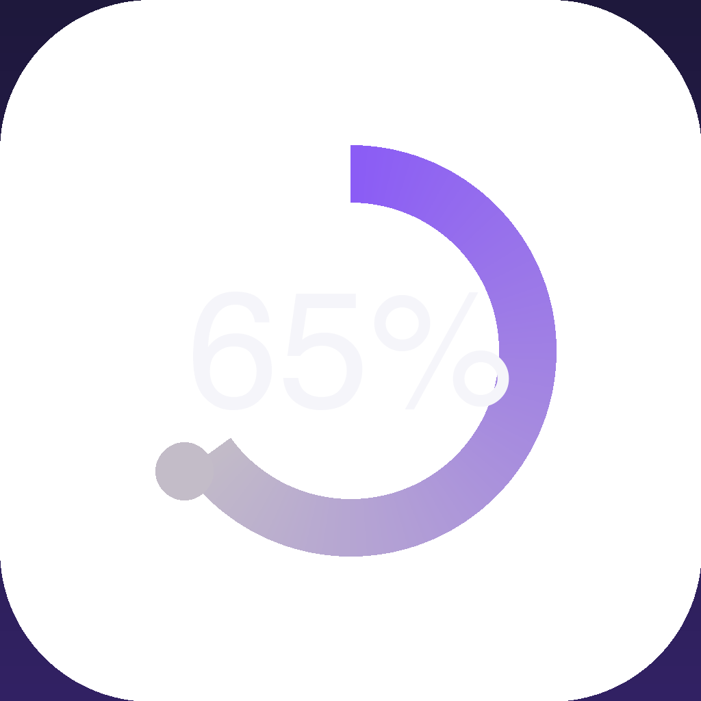

# Kimi Quota Bar · Kimi 套餐额度桌面浮珠

一个常驻 macOS 菜单栏 / Windows 托盘的轻量额度工具。收起时是 60×60 浮珠，展开是 280×252 的三行卡片，显示 **月度、5 小时、7 天已用比例**。可见时每 60 秒刷新，隐藏时暂停轮询。



## v0.2.0 功能

- **精致三行卡片**：32px 小环、两位小数、重置倒计时、Kimi Code 接口占比；双击任意已启用额度行，把它投射到浮珠，不增加网络请求。
- **可信数据状态**：后端持有最后成功快照并合并并发请求；暂时失败保留旧数据并标明时间，超过 5 分钟浮珠改为 `—`，退出或切换账号会丢弃旧响应。
- **8 套完整主题**：深空极光、翡翠庭园、柔彩棱镜、极地冰蓝、落日桃雾、香槟琥珀、樱雾白瓷、石墨银。主题贯通浮珠、卡片、按钮、登录、个人中心、菜单和确认框。
- **按主题保存外观**：按整体、浮珠、卡片、控件、状态编辑颜色、透明度和光晕；每套内置主题独立保存常用配置，切换后自动恢复。支持实时样品、20 步撤销/重做及主题文本导入导出，草稿保存后才影响正式窗口。
- **三档动效**：静止 / 灵动 / 星尘。灵动保留 8 枚基础粒子与内圈游星，15 秒无操作后冻结、交互唤醒；星尘保留旧观赏模式的 16 枚粒子、双游星和辉光。旧观赏开关自动迁移为星尘。
- **可靠浮珠**：贴边收展、双击标题收球、Enter/Space 展开、左右停靠、工作区边界与多 DPI 几何处理。
- **实用工具**：复制白名单额度摘要、查看并复制脱敏诊断、离线设计沙盒。
- **登录与个人中心**：扫码、短信或内嵌官方网页登录；显示脱敏账号与会员信息，退出前二次确认。

系统“减少动态效果”优先于所有动效设置；高对比度模式关闭装饰层。Windows 默认使用透明原生窗口 + CSS 雾面，不再给整窗叠加 Acrylic；macOS 使用 Liquid Glass，失败时回退 Vibrancy / 实色雾面。

## 数据从哪来

应用不内置账号信息。默认读取本机 Kimi 桌面客户端的加密会话，也可在应用内单独登录。令牌只存于本机；访问令牌临近过期时自动续期，应用内会话最长可 90 天免登录。

额度来自官方 `GetSubscriptionStats` 接口。界面只展示接口提供的已用比例、窗口启用状态和重置时间，不推算请求次数、金额或精确 token 数。重置倒计时以服务端字段为准，到达时间后显示“等待更新”，不会在本地强行清零。

主动退出后，应用停止跟随桌面客户端账号并清除本应用的内存快照；不会退出或修改 Kimi 桌面客户端自身登录态。

## 设置与迁移

正式设置保存在应用配置目录的 `settings.json`，与加密会话分离。旧版 `localStorage` 中的主题、浮珠指标和观赏开关只在首次迁移时读取，旧键保留一个版本。写入使用临时文件替换，并保留上一份有效备份。

窗口位置仍单独保存。浮珠和卡片设置由 Rust、托盘与前端共同使用同一份正式配置。

## 安装

到 [Releases](https://github.com/GSSHUO/km/releases) 下载：

| 平台 | 文件 |
|---|---|
| macOS Apple Silicon | `Kimi Quota Bar_x.x.x_aarch64.dmg` |
| macOS Intel | `Kimi Quota Bar_x.x.x_x64.dmg` |
| Windows x64 | `.msi` 或 `.exe`（当前用户安装） |

macOS 拖入“应用程序”。未签名应用首次打开可右键 → 打开；本机自构建通常无此提示。

## 自己构建与检查

环境：Node.js、Rust（rustup，最低 1.77.2）和 Xcode 命令行工具；Windows 需要 VS Build Tools。

```bash
npm ci
npm run check       # 前端逻辑测试 + Rust 单元测试
npm run test:ui     # UI 静态契约检查
cargo fmt --check --manifest-path src-tauri/Cargo.toml
npm run build       # Release 编译与安装包
```

macOS 产物：

- App：`src-tauri/target/release/bundle/macos/Kimi Quota Bar.app`
- DMG：`src-tauri/target/release/bundle/dmg/`

`tauri build` 打 DMG 时可能清理中间 `.app`。需要单独保留时，先 `npx tauri bundle --bundles app`，再打 DMG。

### 离线沙盒与自检

在本项目根目录启动任意静态服务器，例如：

```bash
python3 -m http.server 8765 --bind 127.0.0.1
```

打开 `http://127.0.0.1:8765/design-case/sandbox.html`。沙盒覆盖 0/25/49.99/50/75/79.99/80/99.99/100%、缺失、禁用、登录失效、旧数据、过期和异常字段；不读取账号、不请求 Kimi、不写真实设置。

```bash
"/Applications/Kimi Quota Bar.app/Contents/MacOS/kimi-quota-bar" --check-settings  # 默认设置与 8 主题，离线
"/Applications/Kimi Quota Bar.app/Contents/MacOS/kimi-quota-bar" --check-layout    # 窗口尺寸契约，离线
"/Applications/Kimi Quota Bar.app/Contents/MacOS/kimi-quota-bar" --check           # 真实账号额度链路
"/Applications/Kimi Quota Bar.app/Contents/MacOS/kimi-quota-bar" --check-session   # 自有会话加解密往返
```

`--check-refresh`、`--check-qr` 会操作真实认证流程，不属于普通视觉回归，不应放入自动检查。

## 两个版本分支

旧版保留在 `jie/feat-dev-v1`，新版在 `kimi-bar-new`。切换源码版本：

```bash
git switch jie/feat-dev-v1   # 旧版
git switch kimi-bar-new      # 新版
```

切换后重新执行 `npm run build` 并安装对应产物。两个分支共享同一个应用标识，安装新版会替换 `/Applications/Kimi Quota Bar.app`，不是两个应用同时并存。

## 发版

`.github/workflows/release.yml` 在 tag 推送后执行离线检查，并并行构建 macOS Apple Silicon / Intel 与 Windows 安装包，生成 Draft Release：

```bash
git tag v0.2.0
git push origin v0.2.0
```

## 验证边界

浏览器沙盒不能证明原生玻璃、桌面穿透、Windows WebView2 或实际功耗。发布时应分别记录 macOS / Windows 真实 GUI、壁纸、DPI、失焦、收展与性能结果；没有 Windows 实机结果时，不宣称 Windows 视觉验收已经完成。

## 隐私

除 Kimi 官方认证、会员与额度接口外，应用不产生在线字体、装饰图片或追踪请求。复制摘要与诊断只包含白名单内容，不包含原始令牌、账号 ID、回调 URL、原始接口响应或本机路径。
